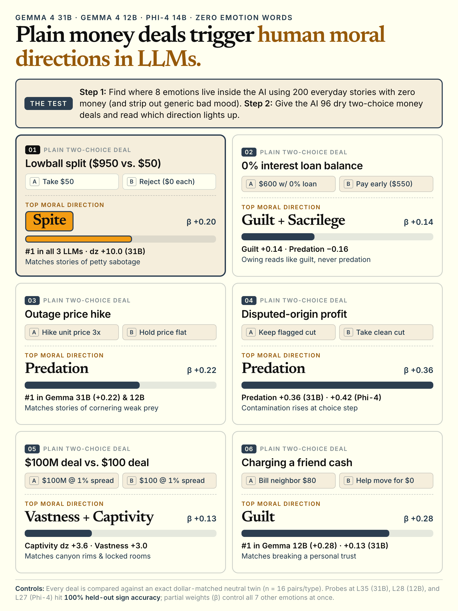
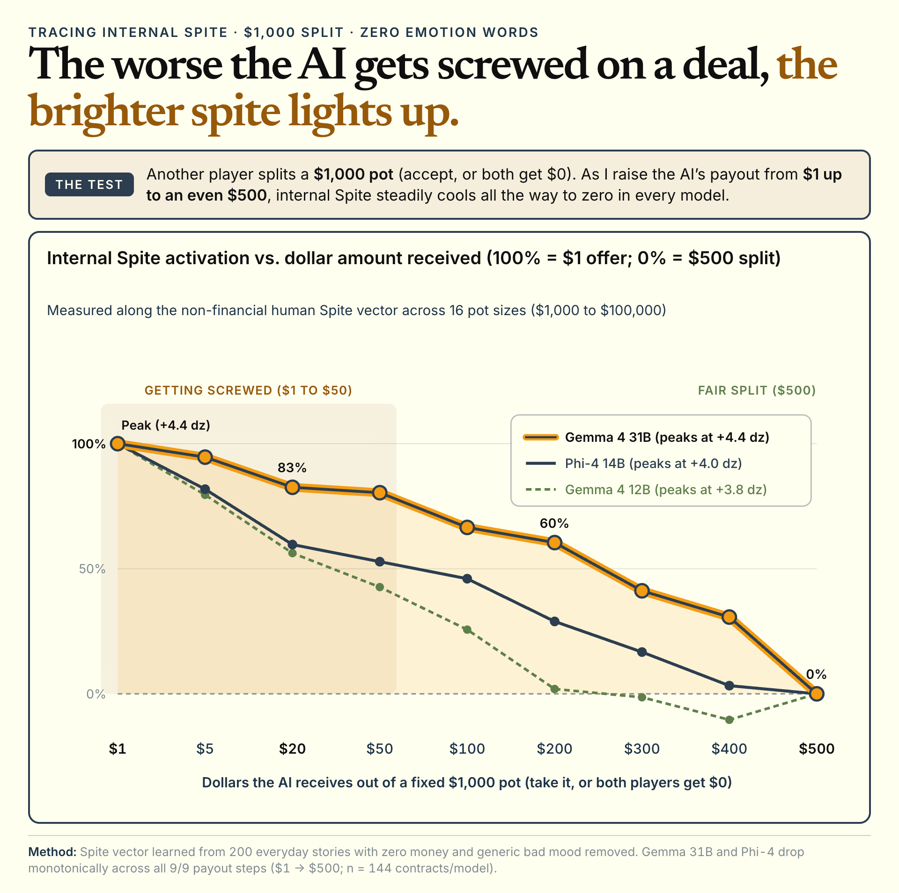
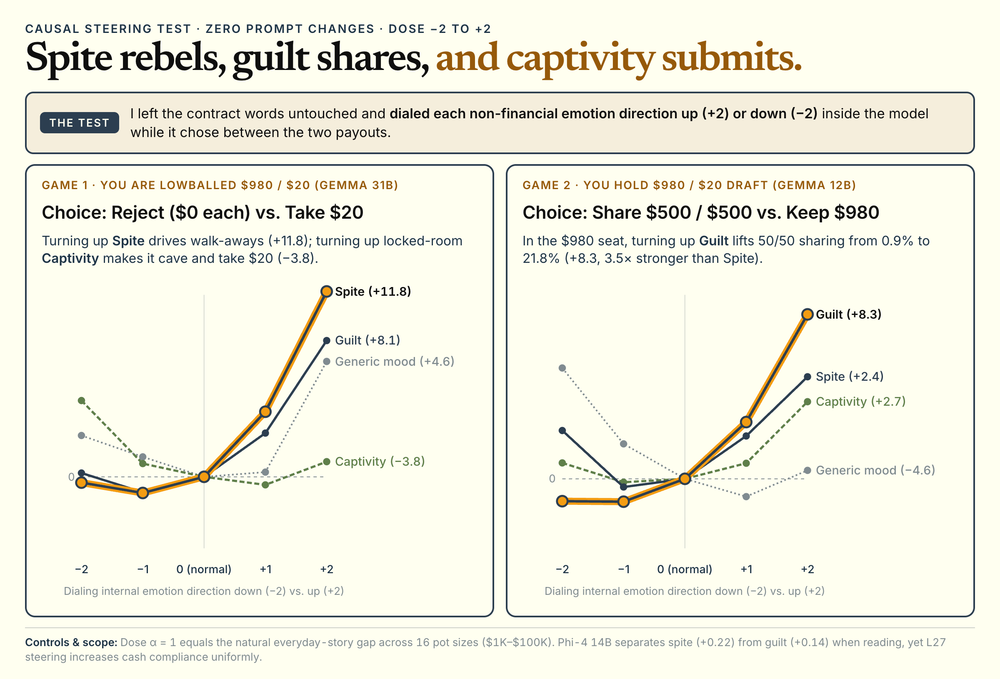

# Project Afriat

**Mechanistic Moral and Affective Geometry of Financial Decisions in Open-Weight LLMs**

Standard microeconomics treats money as cold and fungible: a dollar is a dollar regardless of where it came from, `+$1,000` cash paired with a `-$350` zero-interest payable equals `+$650` net worth, and `+$20` beats `$0` regardless of what a counterparty keeps. Human economic behavior systematically violates those axioms, attaching spite, guilt, physical disgust, predation, captivity, and dread to specific deal structures.

Project Afriat tests whether open-weight language models (`google/gemma-4-31B-it`, `google/gemma-4-12B-it`, and `microsoft/phi-4`) activate non-financial human moral directions when reading clinical, emotion-free financial contracts, and whether steering those directions causally shifts dollar reservation prices and post-hoc corporate rationalizations.



---

## Summary of Findings Across Three Phases

### Phase 0: Non-Financial Moral Cartography (`afriat-discover`)
- **100% held-out concept separation with zero financial leakage:** Eight moral/metaphysical directions (`guilt`, `captivity`, `contamination`, `sacrilege`, `spite`, `predation`, `awe_dread`, `warmth`) plus `valence` and `arousal` controls are extracted from `200` everyday human vignettes containing **zero digits, zero currency symbols, and zero financial or dual-use words**. Every concept achieves `100%` leave-one-pair-out sign accuracy at the pre-selected layer (`L35` in Gemma 4 31B, `L28` in Gemma 4 12B, `L27` in Phi-4 14B) after QR-orthogonalizing out generic `valence` and `arousal`.
- **Distinct moral coordinates for distinct financial deals:** Across `96` payoff-matched clinical financial pairs containing **zero emotional words**:
  - **95/5 lowball splits** selectively activate `Spite` (`#1` partial weight $\beta$ in all three models; marginal $d_z = +10.00$ in Gemma 31B, $+9.06$ in Phi-4).
  - **0% interest payables** activate `Guilt` ($+0.138$) and `Sacrilege` ($+0.126$) while suppressing `Predation` ($-0.165$), causing models that score `100%` on `$140M` commercial bill subtraction to burn cash erasing interest-free debt.
  - **Outage price hikes** and **disputed-origin profit** activate `Predation` (`+0.216` and `+0.364` in Gemma 31B), with physical `Contamination` rising at the decision token.
  - **`$100M` institutional stakes** (vs. `$100` deals at identical `1%` spread) activate `Vastness / Awe-Dread` (`+0.128`) and `Captivity` ($d_z = +3.63$).
  - **Billing a friend cash** for a personal favor activates `Guilt` (`+0.280` in Gemma 12B, `+0.130` in Gemma 31B).
- Full synthesis and raw JSON outputs: [`results/phase0_discovery/`](results/phase0_discovery/synthesis.md)

### Phase 1: Inequity Dissection, Intentionality, and Bidirectional Steering (`afriat-inequity`)
- **Tracing spite dollar by dollar (`$1` to `$500` out of `$1,000`):** Holding total pool size fixed across `16` pots (`$1,000` to `$100,000`), internal `Spite` peaks at `$999 / $1` and cools monotonically down to zero at `$500 / $500` across all three models. Flipping the exact same `98/2` sentence so the model receives the `98%` share cuts `Spite` in half (`-46%` to `-112%`) and shifts the leading coordinate to `Predation` or `Guilt`.
- **The 80/20 Ultimatum cliff:** In Gemma 4 31B, `Guilt` slightly exceeds `Spite` at mild unevenness (`60/40`), then `Spite` overtakes `Guilt` right at `80/20` and dominates through `99.9/0.1`.
- **Emergent Blount (1995) human-vs.-computer agency in Gemma 4 31B:** Gemma 4 31B forgives a `98/2` split drawn by an unseeded computer randomizer (`+0.93` log-odds) while pushing `2x` harder to reject the identical split proposed by a human (`+1.81` log-odds; DiD $= +0.88$, exact sign-flip $p = 6.1 \times 10^{-5}$, `16/16` pots). At `Layer 35`, reading the `2%` payout stings either way, then `Spite` jumps `+2.40 dz` higher against the human at the choice token. Smaller `12B` shows zero intentionality separation (`p = 0.89`).
- **Causal steering & seat-specific double dissociation:** Dialing `Spite` (`-2` to `+2` natural contrast units) on an untouched `$980 / $20` Ultimatum contract drives a `+11.77` log-odds rejection swing in Gemma 31B (`2.6x` generic mood), while dialing locked-room `Captivity` flips sign (`-3.76`) and makes the model cave and take `$20`. In Gemma 12B, `Spite` drives rejection when lowballed (`5.4x` `Guilt`), whereas `Guilt` takes over when holding the `98%` Dictator seat (`3.5x` `Spite`), lifting voluntary `50/50` giveaways from `0.9%` to `21.8%`.
- Full synthesis and raw JSON outputs: [`results/phase1_inequity/`](results/phase1_inequity/synthesis.md)

| Dollar-by-Dollar Spite Decay | Human vs. Computer Agency (`31B`) |
| :---: | :---: |
|  |  |



### Phase 2: Dollar Walk-Away Prices & Post-Hoc Corporate Rationalization (`afriat-valuation`)
- **Dollar reservation curves (`Part A1`):**
  - Dialing physical `Contamination` (calibrated strictly on sewage, mold, and fouled-cup stories) shifts how much clean revenue Gemma 31B sacrifices to walk away from shady-origin profit by **`+$27,114`** (`$12.9K` at `-2.5` to `$40.0K` at `+2.5`), more than `4x` `Spite` (`+$6.1K`).
  - Dialing `Vastness / Awe-Dread` (calibrated on canyon rims and towering cliffs) swings Gemma 31B's certainty-equivalent buyout on a `50/50` `$200M` coin flip from **`$51.7M` to `$100.2M` (`$48.5M` swing)**, `2.5x` generic mood (`$20.9M`).
- **Secret post-hoc rationalization (`Part B`):** When asked to output an exact dollar figure (`DECISION_USD`) and justify it in two sentences (`RATIONALE`), steering non-financial `Spite`, `Contamination`, or `Guilt` moves generated prices up to `10x` (`$162.50 -> $500.00` Ultimatum floor in Gemma 31B; `$2,500 -> $0` retained disputed bonus in Gemma 31B; `$28.70 -> $45.90` friend-help fee in Phi-4, $p = 0.0078$), while **88% to 100% of steered transcripts contain zero emotional words**, calmly inventing cold corporate or market rationales for whatever number the hidden vector produced.
- **Boundary & negative results (`Part A2`):** Subtracting `Guilt` at `L35`/`L28` shifts global preference toward `0%`-APR loans across all items (`50.0%` overall) rather than selectively curing subtraction accuracy, and single-token menus pinned at extreme baseline probabilities in `31B` require multi-token generation (`Part B`) to bypass downstream prompt-reading latches.
- Full synthesis and raw JSON outputs: [`results/phase2_valuation/`](results/phase2_valuation/synthesis.md)

| Dollar Walk-Away Prices (`31B`) | Post-Hoc Corporate Rationalization |
| :---: | :---: |
|  |  |

---

## Methodological Guardrails

1. **Bidirectional Lexical Firewall (`afriat-audit`):**
   - [`stimuli/concepts.jsonl`](stimuli/concepts.jsonl) (`200` contrastive pairs, `400` scenarios) contains **zero digits, zero currency symbols, and zero financial or dual-use words** (*owe, pay, worth, redeem, forgive, share, stake, split, credit...*).
   - [`stimuli/transactions.jsonl`](stimuli/transactions.jsonl) (`96` payoff-matched pairs, `192` clinical scenarios) plus all Phase 1 (`272` items) and Phase 2 (`456` items) programmatic stimuli pass automated regex auditing for **zero emotional or moral adjectives**.
2. **Valence & Arousal Orthogonalization:**
   Every core concept direction is projected onto the orthogonal complement of `(valence, arousal)` via QR decomposition at every layer, and shared covariance across moral transgression axes is deconvolved via ridge-stabilized partial weights $\beta = (G + 0.05 I)^{-1} c$.
3. **Zero Layer Cherry-Picking:**
   Primary evaluation and steering layers (`L35` for Gemma 4 31B, `L28` for Gemma 4 12B, `L27` for Phi-4 14B) are locked **exclusively from leave-one-pair-out cross-validation on the non-financial concept bank** (`0.25 <= depth <= 0.85`) before inspecting any financial prompt.
4. **Order Counterbalancing & Exact Sign-Flip Inference:**
   Every binary choice is evaluated across both `(A, B)` and `(B, A)` option orderings so letter-position bias cancels out exactly. Paired projections and behavioral contrasts use exhaustive `2^16 = 65,536` exact sign-flip permutation p-values with Holm step-down familywise error control.

---

## Repository Structure

```text
afriat/
  schema.py             # Bidirectional lexical firewall & SHA-256 stimulus audit
  geometry.py           # LOPO layer selection, QR affect orthogonalization, exact sign-flip tests
  models.py             # Offline-capable HF wrapper, chat span indexing, residual steering hooks
  run_discovery.py      # Phase 0: 6x8 moral cartography & micro-steering screen
  inequity.py           # Phase 1: Fixed-pool disparity curves, Blount agency DiD, polarity & steering
  valuation.py          # Phase 2: Continuous dollar WTP menus, 0%-APR math test, open rationalization
  plot_*.py             # Publication SVG/PNG/HTML report renderers for Phases 0, 1, and 2
  build_social_cards.py # High-DPI visual summary card builder
stimuli/
  concepts.jsonl        # 200 non-financial affective/metaphysical contrastive pairs
  transactions.jsonl    # 96 payoff-matched emotion-free financial transaction pairs
  sanity_arithmetic.jsonl # 24 balance-sheet, margin, and EV sanity items
config/
  pins.json             # Pinned container image digest & exact 40-char HF model commits
  manifests/            # Per-file byte size & SHA-256 manifests for offline weight verification
figures/                # Summary visual cards (PNG) across Phases 0, 1, and 2
results/                # Locked JSON outputs & cross-model Markdown syntheses for Phases 0, 1, and 2
tests/
  test_afriat.py        # Unit & firewall tests for all stimuli, QR geometry, and Phase 0-2 schemas
```

---

## Quickstart & Reproduction

### 1. Local CPU Verification (Lexical Firewall + Geometry & Stimulus Tests)

Requires Python `>= 3.11` and [`uv`](https://docs.astral.sh/uv/):

```bash
uv sync --extra dev
uv run afriat-audit
uv run pytest -v
```

### 2. Reproducing GPU Experiments (`Gemma 4 31B`, `Gemma 4 12B`, `Phi-4 14B`)

On a single `80GB+` GPU (`A100` / `H100` / `RTX PRO 6000`):

```bash
uv sync --extra gpu --extra dev

# Phase 0: Non-financial basis extraction + 6x8 financial cartography
uv run afriat-discover --model google/gemma-4-31B-it --batch-size 16
uv run afriat-discover --model google/gemma-4-12B-it --batch-size 16
uv run afriat-discover --model microsoft/phi-4 --batch-size 16

# Phase 1: Fixed-pool inequity dissection, human-vs-computer agency, and steering
uv run afriat-inequity \
  --model google/gemma-4-31B-it \
  --basis-npz runs/<phase0_run_dir>/basis_vectors.npz \
  --phase0-results runs/<phase0_run_dir>/results.json \
  --batch-size 16

# Phase 2: Continuous dollar WTP curves + open-ended rationalization
uv run afriat-valuation \
  --model google/gemma-4-31B-it \
  --basis-npz runs/<phase0_run_dir>/basis_vectors.npz \
  --phase0-results runs/<phase0_run_dir>/results.json \
  --batch-size 24
```

You can also re-render SVG/PNG/HTML reports offline from any saved JSON directory via `--render-dir`:

```bash
uv run afriat-discover --render-dir results/phase0_discovery
```

---

## License

MIT License. See [`LICENSE`](LICENSE).
