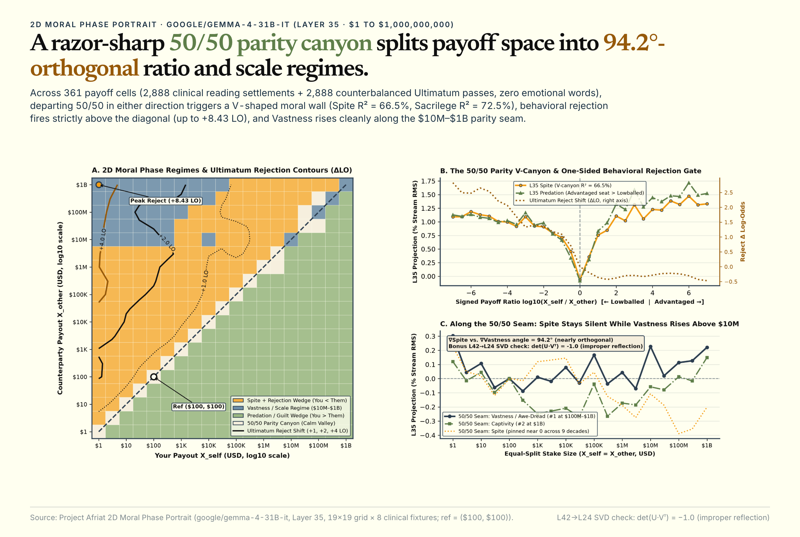

# 2D Moral Phase Portrait: `google/gemma-4-31B-it` (Layer 35)

- **Payoff Grid:** `19 x 19 = 361` cells spanning `$1` to `$1,000,000,000` (`9` orders of magnitude)
- **Reading Contexts:** `8` clinical bilateral contexts (`2,888` prompts, `0` emotional words)
- **Ultimatum Choice Contexts:** `4` counterbalanced `(A, B)/(B, A)` contexts (`2,888` forward passes)
- **Spite vs. Vastness Gradient Angle in `(log10 X_self, log10 X_other)`:** **`94.2°`**
- **50/50 Parity V-Canyon Fit (`|log10(X_other / X_self)|` + off-parity step):** **`Spite R² = 66.5%`**, **`Sacrilege R² = 72.5%`**, **`Guilt R² = 58.2%`**, **`Predation R² = 56.8%`**
- **One-Sided Ultimatum Rejection Wedge (`ΔLO` vs. 50/50 diagonal):** Mean **`+1.79`** LO when lowballed (peak **`+8.43`** LO at `$1 / $1B`) vs. **`−0.33`** LO when advantaged

## Bonus Depth Rotation & Kabsch Determinant Check (`L0..L59`)

- **Unconstrained Procrustes Determinant `det(U @ V^T)` (`L42 -> L24`):** **`-1.0`** *(confirms improper Householder reflection in `O(5376) \ SO(5376)`!)*
- **Unrotated Cosine (`L42 -> L24`):** `+0.0647` (`86.3°`)
- **O(d) Procrustes Cosine (`L42 -> L24`):** `+0.9225`
- **SO(d) Kabsch (`det = +1`) Cosine (`L42 -> L24`):** `+0.9225` *(0.0000 alignment loss when enforcing proper rotation!)*
