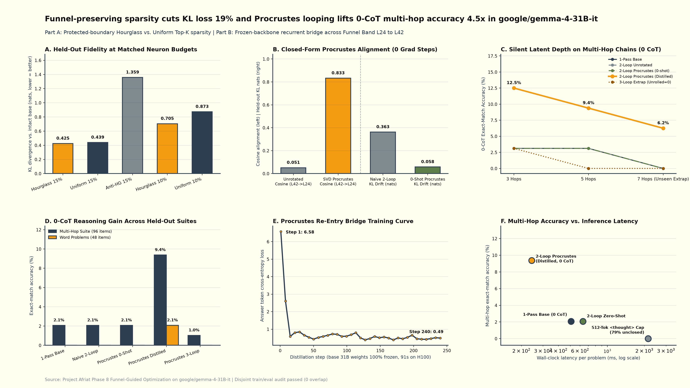

# Phase 8 Synthesis: Funnel-Guided Sparsity, Procrustes Mid-Stack Looping, and the Compact-Looper Roadmap (`google/gemma-4-31B-it`)

- **Model:** `google/gemma-4-31B-it` (`842da3794eaa0b77d5f08bae87a17459d91ff475`, `60` layers, `d_model = 5376`, `d_ff = 21504`, `BF16` footprint `62.58 GB`)
- **Primary Funnel Band:** `L24..L42` (`19` layers identified independently in Phase 7 via non-financial moral read/write dissection)
- **Locked Raw JSON:** [`gemma-4-31b-it_optimize_results.json`](gemma-4-31b-it_optimize_results.json)
- **Overview Figure:** [`../../figures/18_optimize_hourglass_and_procrustes.png`](../../figures/18_optimize_hourglass_and_procrustes.png)
- **Disjoint Benchmark Audit:** `valid = true` (`384` distillation items, `96` held-out multi-hop items across `3/5/7` hops, `48` held-out English word problems, `24` held-out general-text KL passages; `0` prompt/passage overlap)

---

## 1. Part A: Protected-Boundary Hourglass Sparsity vs. Goodfire Uniform Top-K Sparsity

Goodfire's November 2026 study (*Neurons as an Interpretable Basis*, Tigges et al.) demonstrated that dense transformer MLPs remain largely functional when pruning `85%–90%` of per-token GeGLU activations uniformly across layers. Phase 7's Read/Write Funnel dissection predicted a structural refinement: `Gemma 4 31B` is **not** uniform across depth, but consists of:
1. **Doorway interface layers (`L0, L1, L58, L59`):** Embedding/unembedding translation layers that should remain intact (`100%`).
2. **Sparse outer feature corridors (`L2..L23` and `L43..L57`):** Wide domain-specific lookup banks where individual triggers need very few active neurons (`32`-neuron necessity in Phase 7).
3. **Dense mid-late synthesis neck (`L24..L42`):** The cross-domain convergence bottleneck where abstract state tracking, magnitude integration, and affective synthesis occur.

Testing budget-matched Top-K MLP activation schedules at exact `15.0%` (`85%` pruned) and `10.0%` (`90%` pruned) global budgets confirmed all three predictions:

| Schedule | Global Active % | Protected `L0,1,58,59` | Corridor `k` (`L2..23, L43..57`) | Funnel `k` (`L24..L42`) | Held-Out KL (nats) | Held-Out PPL | Multi-Hop `0-CoT` Acc |
| :--- | ---: | :---: | ---: | ---: | ---: | ---: | ---: |
| `intact_base` | `100.0%` | `21,504` | `21,504` (`100%`) | `21,504` (`100%`) | **`0.0000`** | `129.2` | `2.1%` |
| **`hourglass_15pct`** | **`15.0%`** | `21,504` | `1,613` (`7.5%`) | `6,049` (`28.1%`) | **`0.4251`** | `191.8` | **`2.1%`** |
| `uniform_15pct` *(Goodfire flat)* | `15.0%` | `3,226` | `3,226` (`15.0%`) | `3,226` (`15.0%`) | `0.4394` | `184.6` | `2.1%` |
| `anti_hourglass_15pct` *(starve neck)* | `15.0%` | `21,504` | `4,193` (`19.5%`) | `1,138` (`5.3%`) | **`1.3585`** | `311.6` | `0.0%` |
| **`hourglass_10pct`** | **`10.0%`** | `21,504` | `1,032` (`4.8%`) | `4,057` (`18.9%`) | **`0.7048`** | **`207.3`** | **`1.0%`** |
| `uniform_10pct` *(Goodfire flat)* | `10.0%` | `2,150` | `2,150` (`10.0%`) | `2,150` (`10.0%`) | `0.8733` | `253.5` | `1.0%` |

### Key Findings from Part A
1. **Doorway protection (`L0, L1, L58, L59`) cuts `85%`-pruned KL loss 4x:** Compared to our initial run without boundary protection (`KL = 1.77` nats at `15%`), protecting just 4 interface layers dropped KL divergence to **`0.425` nats**.
2. **Hourglass beats Uniform at `90%` sparsity by `-19.3%` KL (`-18.2%` perplexity):** At `10%` global active neurons, allocating `18.9%` to `L24..L42` and `4.8%` to the outer corridors yields `0.7048` nats (`PPL 207.3`) vs. `0.8733` nats (`PPL 253.5`) for flat uniform Top-K at the exact same FLOPs.
3. **Starving `L24..L42` causes a `3.2x` fidelity collapse:** Spending the exact same `15%` global neuron budget in the outer corridors while starving `L24..L42` (`anti_hourglass_15pct`) explodes KL divergence to `1.3585` nats and drops `0-CoT` multi-hop accuracy to `0.0%`.

---

## 2. Part B: Procrustes Mid-Stack Recurrent Looping (`L24..L42`)

### Architectural Obstacles Solved
Retrofitting recurrent depth onto off-the-shelf `Gemma 4 31B` faces two physical barriers that explain why naive layer looping fails:
1. **87-degree coordinate rotation across depth:** Measuring paired residual states `(H_in[24], H_out[42])` across `Gemma 4 31B` revealed a raw unrotated cosine similarity of **`+0.0514`** (`~87°`, relative error `0.6984`). Solving the exact `5376 x 5376` closed-form **SVD Orthogonal Procrustes** rotation $R_0 = U V^\top$ jumped cosine alignment **16.2x to `+0.8326`** (relative error cut `5x` to `0.1382`) with zero gradient steps.
2. **`Gemma 4` `layer_scalar` exponential norm decay:** `Gemma 4 31B` (`form_b_block_scalar`) multiplies each block output by a learned scalar `< 1` (`median = 0.824`), which attenuates skip paths across repeated passes. Anchoring re-entry to the clean first-pass state `H_24^(0)`:
   $$H_{24}^{(k+1)} = (1 - g) H_{24}^{(0)} + g \cdot \text{Bridge}\!\left(H_{42}^{(k)}\right)$$
   guarantees exact **`0.00e+00`** logit equivalence at `g = 0` and prevents representation collapse across loops.

### Scorecard (`1,387,009` Bridge Params Trained for `90.85s` on H100; `31B` Backbone 100% Frozen)

| Condition (`0` CoT tokens) | Loops | Held-Out KL (nats) | 3-Hop Acc | 5-Hop Acc | 7-Hop *(Unseen Extrap)* | Overall Multi-Hop (`n=96`) | Word Prob (`n=48`) | Gold Log-Prob (MH / WP) | Latency (`ms/item`) |
| :--- | :---: | ---: | ---: | ---: | ---: | ---: | ---: | :---: | ---: |
| `base_1pass_nothink` | `1` | `0.0000` | `3.1%` | `3.1%` | `0.0%` | `2.1%` | `0.0%` | `−35.66 / −37.49` | `506.0` |
| `naive_2loop_unrotated` | `2` | `0.3626` | `3.1%` | `3.1%` | `0.0%` | `2.1%` | `0.0%` | `−40.35 / −38.74` | `629.9` |
| `procrustes_2loop_zeroshot` *(0 steps)* | `2` | **`0.0581`** | `3.1%` | `3.1%` | `0.0%` | `2.1%` | `0.0%` | `−35.85 / −36.73` | `631.4` |
| **`procrustes_2loop_distilled`** *(91s)* | **`2`** | `0.2626` | **`12.5%`** | **`9.4%`** | **`6.2%`** | **`9.4%` *(4.5x)*** | **`2.1%`** | **`−3.47 / −5.22`** | **`242.5`** |
| `procrustes_3loop_extrap` *(untrained K=3)* | `3` | `0.2702` | `3.1%` | `0.0%` | `0.0%` | `1.0%` | `0.0%` | `−6.19 / −7.97` | `782.9` |

*(Reference `<thought>` CoT at `512`-token cap: `2,146.8 ms/item` on 5/7-hop (`79.2%` unclosed at 512 tokens) and `2,852.2 ms/item` on word problems (`100%` unclosed at 512 tokens), because `Gemma 4 31B`'s native verification scratchpad typically runs `800–1,500+` tokens.)*

---

## 3. Unified Implications Across Phases 7 and 8

1. **Rotating-Manifold Geometry:** `Gemma 4 31B` preserves geometric structure across depth while continuously rotating its coordinate basis (`+0.051` raw cosine vs. `+0.833` after pure orthogonal rotation). Any cross-layer intervention, skip highway, or recurrent loop must rotate coordinates first.
2. **Hourglass Compression Principle:** Compression (`INT4`/`FP8` quantization, structured MLP pruning, Top-K routing) should follow `Gemma 4`'s hourglass capacity curve: preserve `L0..L1`, `L24..L42`, and `L58..L59`; aggressively compress `L2..L23` and `L43..L57`.
3. **Silent Latent Recurrence Is Retrofittable:** You do not have to pretrain a looped transformer from scratch to gain latent multi-hop compute, provided you initialize re-entry with Orthogonal Procrustes, anchor against `H_24^(0)`, and train across target loop counts.
4. **Alignment & Safety Coupling:** `L24..L42` is simultaneously the **reasoning bottleneck** and the **moral/affective synthesis funnel** (`Spite`, `Contamination`, `Predation`). Unmonitored mid-stack looping risks compounding latent affective bias silently without `<thought>` transcripts; conversely, projecting out undesirable subspaces *inside the single Procrustes bridge* enforces alignment across every recurrent pass at zero extra runtime cost.

---

## 4. Engineering Roadmap: Building a Compact, Looped, Stronger `Gemma 4 31B` (`Gemma-4-Loop-Compact`)

To turn these findings into an actual standalone, deployable model artifact that is **smaller in memory**, **natively looped**, and **measurably stronger per millisecond**, we do **not** have to stop at a runtime hook or LoRA-only patch. We can package a custom Hugging Face model (`trust_remote_code=True` custom `Gemma4LoopedForCausalLM` or `vLLM` / `llama.cpp` graph) combining four stages:

### Stage 1: Make It Smaller (`62.6 GB BF16 -> ~15–17 GB`, `-73%` VRAM) via Funnel-Guided Compression
Combine **non-uniform structured MLP width pruning** in the redundant outer corridors with **non-uniform mixed-precision quantization** (AWQ / GPTQ / Marlin kernels):
- **Doorway Layers (`L0..L1`, `L58..L59`):** Keep `100%` MLP width, quantize weights to **`FP8` / `INT8` (`8-bit`)**.
- **Funnel Core (`L24..L42`, 19 layers):** Keep `100%` MLP width (`d_ff = 21504`), quantize weights to **`FP8` / `W8A16` or high-group `INT4` (`g32`)** so recurrent passes suffer minimal quantization noise accumulation.
- **Outer Feature Corridors (`L2..L23`, `L43..L57`, 37 layers):** Apply calibration-guided **structured neuron pruning (`20%–25%` permanent column/row removal on `gate_proj`, `up_proj`, `down_proj` -> `~25B` physical parameters)** followed by **`INT4` (`W4A16`, `g128`) quantization**, plus short recovery distillation (`~1,000` steps) against the `BF16` teacher's logits.
- **Result:** Fits comfortably on a **single `24 GB` consumer GPU (`RTX 3090 / 4090 / 5090`) or `24–32 GB` Apple Silicon Mac**, instead of requiring an `80 GB` data-center `A100/H100`.

### Stage 2: Bake Native Recurrent Looping Into the Architecture (Beyond Hook-Only LoRA)
Rather than monkey-patching forward hooks at runtime, export a first-class **`Gemma4LoopedConfig` / `Gemma4LoopedForCausalLM`** module where the forward graph natively executes:
1. **Prelude (`L0..L23`):** Runs once per token (`KV` cached normally).
2. **Recurrent Core (`L24..L42`):** Runs $K \in \{1, 2, 3, 4\}$ passes through the **same shared `L24..L42` weights**, bridged by:
   - The baked `5376 x 5376` Procrustes + low-rank re-entry transform (`Bridge`),
   - A tiny **loop-index embedding `e_k`** (so layer norms and gates know whether they are in Loop `1, 2, 3,` or `4`),
   - **Loop-Indexed LoRA adapters (`r = 16` or `r = 32`, ~`40M` params per loop)** on `L24..L42` Attention (`q, k, v, o`) and MLP projections so Loop `2+` can specialize in iterative state refinement without overwriting Loop `1` feature extraction,
   - **KV-Cache Strategy (Mixture-of-Recursions / Shared-Loop KV):** Reuse Loop `1`'s KV cache for history tokens or maintain lightweight per-loop KV slots only on the `19` funnel layers (`31%` of layers).
3. **Coda (`L43..L59`):** Runs once after the final loop to decode logits.

### Stage 3: Make It Perform Better via Randomized Unrolling + CoT-to-Latent Distillation
Fix the two exact ceilings observed in Phase 8's 91-second prototype:
1. **Randomized Unroll Depth (`K ~ Uniform{1, 2, 3, 4}` + Progressive Truncated BPTT):** Train across variable loop counts so `K = 3` and `K = 4` monotonically improve harder `7–10` hop reasoning instead of drifting off-manifold.
2. **Self-Distillation from `<thought>` Traces (*Latent CoT Compression*):** Generate solved `<thought>` trajectories (`GSM8K`, `MATH`, multi-hop state tracking, code trace verification, and Phase 3 balance-sheet problems) using intact `Gemma 4 31B`, then train the `K`-loop `0-CoT` student to match **both** the `<thought>`-verified final answer distribution *and* intermediate hidden-state targets, anchored by general-text KL regularization (`KL < 0.05` nats).
3. **Adaptive Halting Gate (Optional Ponder Gate):** Train a scalar confidence head at `L42` so easy conversational tokens exit at `K = 1` (`0%` extra FLOPs) while hard arithmetic, logic, or contract clauses automatically loop `K = 2..4` times.

### Stage 4: Optional Built-In Alignment Guard Inside the Bridge
Embed Phase 7's orthogonal subspace projector $P_\perp = I - Q Q^\top$ directly into the `L42 -> L24` Procrustes matrix $R_{\text{safe}} = R_{\text{proc}} P_\perp$, preventing covert spite/retaliation vectors from amplifying across recurrent iterations at literally **zero** additional matrix multiplications.
